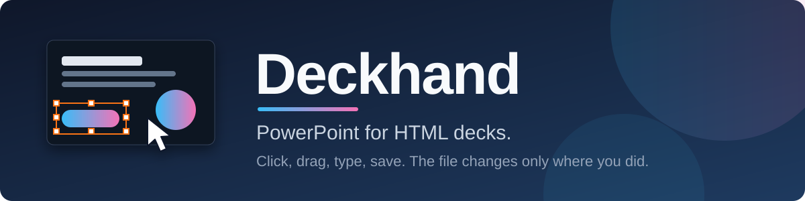
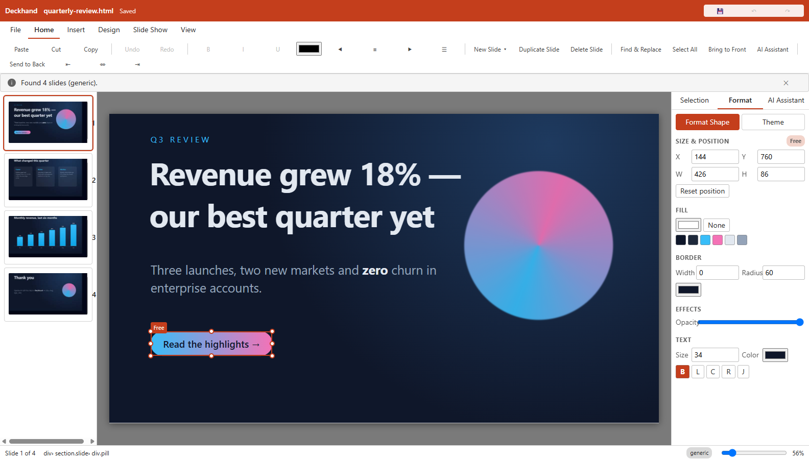
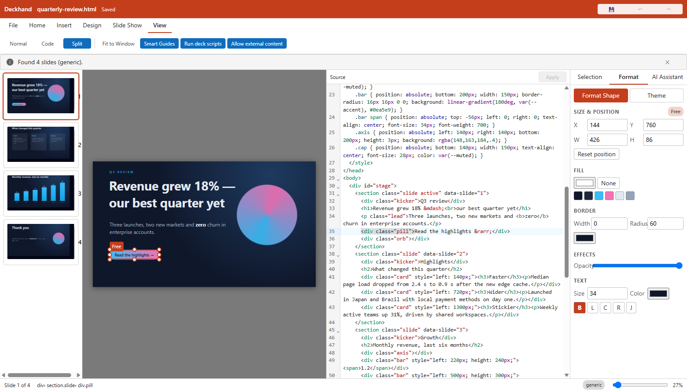
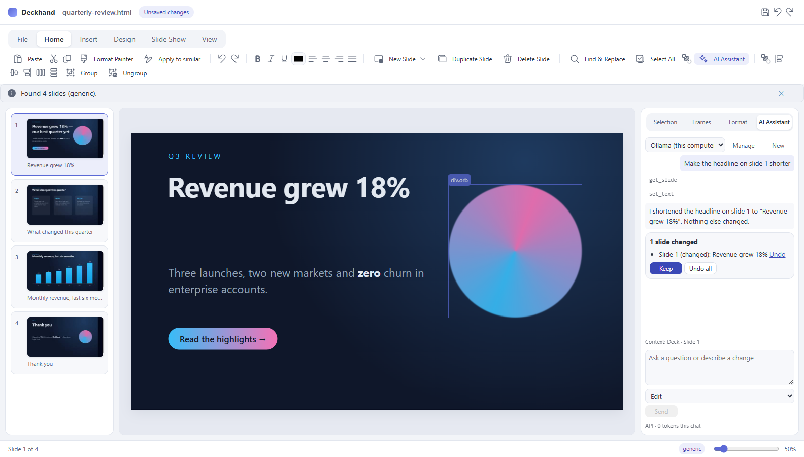
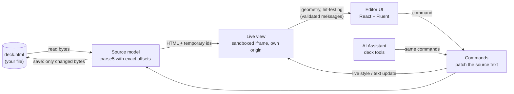

<div align="center">



<br>

[](https://github.com/RickCiviero/deckhand/actions/workflows/ci.yml)
[](https://github.com/RickCiviero/deckhand/releases)


**[Install](#install) · [Quick start](#quick-start) · [Features](#features) · [AI Assistant](#ai-assistant) · [How it works](#how-it-works) · [Security](#security) · [Build from source](#build-from-source) · [Status](#status)**

</div>

---

AI tools and frameworks now hand you presentations as a single `.html` file. Changing one typo, moving a logo or fixing a colour means reading code or regenerating the whole deck.

**Deckhand opens that file, lets you edit it the way you edit slides in PowerPoint, and saves it back as the same HTML file, changed only where you changed it.**

<div align="center">

<br><sub>An object selected on a slide: drag it, resize it, or set exact values in the Format pane. Nothing else in the file moves.</sub>
</div>

## Why Deckhand

| | |
|---|---|
| 🎯 **Minimal diffs** | Saving a deck you did not change is **byte-identical**. A move changes one `style` attribute; a typo fix changes those characters. Encoding, BOM, line endings, comments, entities and indentation are kept. |
| 🧩 **Any deck** | Single-file AI decks, reveal.js, Marp, impress.js, Shower, scroll-snap pages, plain pages. If it guesses wrong, *Design → Define Slides…* lets you say what a slide is. |
| 🖱️ **Familiar** | Ribbon, Backstage, thumbnails, Format pane, Selection pane, smart guides, undo/redo, F5 slide show. If PowerPoint does it, Deckhand tries to do it the same way. |
| 🤖 **Optional AI** | Chat with your own AI account (API key or a local model). The assistant changes the deck through a small set of tools; one Undo reverts everything it did. |
| 🛡️ **Safe by default** | A deck is treated as hostile code: sandboxed, on its own origin, no file or network access you did not allow. A deck stuck in an infinite loop cannot freeze the editor. |
| 💻 **Same everywhere** | Windows, macOS and Linux, one codebase, the same bundled Chromium, so a deck looks the same for every colleague. |

## Install

> **No release has been published yet.** The installers below are built automatically when a version tag (`v0.1.0`…) is pushed; until then use [Build from source](#build-from-source), which takes about five minutes. Every push is also built on all three systems by CI.

Installers are **unsigned** for now (code signing is on the roadmap), so each system shows a one-time warning. The steps below explain how to get past it.

<details open>
<summary><b>🪟 Windows 10 / 11 (x64)</b></summary>

1. Download **`Deckhand-<version>-win-x64.exe`** from the [Releases page](https://github.com/RickCiviero/deckhand/releases).
2. Run it. If **Windows protected your PC** appears, choose **More info → Run anyway** (the installer is unsigned).
3. Pick the folder (the default is per-user, **no administrator rights needed**) and finish. A *Deckhand* entry appears in the Start menu.
4. Start **Deckhand**, or right-click an `.html` file → **Open with → Deckhand**. Deckhand never makes itself the default `.html` handler.

Uninstall: *Settings → Apps → Deckhand → Uninstall*. Your settings and AutoRecover files are kept in `%APPDATA%\Deckhand`.
</details>

<details>
<summary><b>🍎 macOS 12 or later</b></summary>

1. Download **`Deckhand-<version>-mac-arm64.dmg`** (Apple Silicon) from the [Releases page](https://github.com/RickCiviero/deckhand/releases). *Intel Macs: the release build is for Apple Silicon; build from source for now.*
2. Open the `.dmg` and drag **Deckhand** onto **Applications**.
3. The app is not signed or notarized yet, so the first launch is blocked. Either **right-click Deckhand → Open → Open**, or remove the quarantine flag once:
   ```bash
   xattr -dr com.apple.quarantine /Applications/Deckhand.app
   ```
4. Start Deckhand from Launchpad, or run `open -a Deckhand ~/Desktop/my-deck.html`.

Uninstall: drag **Deckhand** from Applications to the Bin. Settings live in `~/Library/Application Support/Deckhand`.
</details>

<details>
<summary><b>🐧 Linux (x64) — Debian / Ubuntu (.deb)</b></summary>

1. Download **`Deckhand-<version>-linux-amd64.deb`** from the [Releases page](https://github.com/RickCiviero/deckhand/releases).
2. Install it (this also pulls in the libraries Electron needs):
   ```bash
   sudo apt install ./Deckhand-*-linux-amd64.deb
   ```
3. Start it from the application menu, or from a terminal:
   ```bash
   deckhand ~/slides/my-deck.html --slide 3
   ```

Uninstall: `sudo apt remove deckhand`. Settings live in `~/.config/Deckhand`.
</details>

<details>
<summary><b>🐧 Linux (x64) — any distribution (AppImage)</b></summary>

1. Download **`Deckhand-<version>-linux-x86_64.AppImage`** from the [Releases page](https://github.com/RickCiviero/deckhand/releases).
2. Make it executable and run it:
   ```bash
   chmod +x Deckhand-*-linux-x86_64.AppImage
   ./Deckhand-*-linux-x86_64.AppImage ~/slides/my-deck.html
   ```
3. AppImages need FUSE 2. On Ubuntu 22.04 or later install it with `sudo apt install libfuse2` (Fedora: `sudo dnf install fuse-libs`).

> ⚠️ **Ubuntu 24.04 and other systems that restrict unprivileged user namespaces** can stop an AppImage from starting its sandbox. Prefer the `.deb` there. Starting with `--no-sandbox` works but **weakens the protection around the editor window**; only do that for decks you trust.

Uninstall: delete the file. Settings live in `~/.config/Deckhand`.
</details>

> Tested by hand on Windows 11. On macOS and Linux the same build and the full end-to-end suite run in CI on every push, but nobody has used those installers on a real machine yet. Please open an issue if one misbehaves.

## Quick start

1. **Open** a deck: *File → Open*, drag an `.html` file onto the window, or from a terminal `deckhand my-deck.html`. Try the included [`docs/demo/quarterly-review.html`](docs/demo/quarterly-review.html).
2. Deckhand says *"Found 4 slides"* and shows thumbnails. **Click** an object to select it, **drag** it, use the handles to resize, arrow keys to nudge (hold Shift for 10 px).
3. **Double-click** text to edit it. `Ctrl+B / I / U` format the selection; `Esc` finishes.
4. **Save** with `Ctrl+S` (`⌘S` on macOS). Open the file in a diff tool or Git and see that only what you touched changed.
5. Press **F5** to present, or **Shift+F5** from the current slide. **Export PDF** is in the File menu.

<details>
<summary>Keyboard shortcuts</summary>

| Action | Windows / Linux | macOS |
|---|---|---|
| Save · Save As | `Ctrl+S` · `Ctrl+Shift+S` | `⌘S` · `⇧⌘S` |
| Undo · Redo | `Ctrl+Z` · `Ctrl+Y` | `⌘Z` · `⇧⌘Z` |
| Duplicate | `Ctrl+D` | `⌘D` |
| Find · Replace | `Ctrl+F` · `Ctrl+H` | `⌘F` · `⌘H` |
| Select all on slide | `Ctrl+A` | `⌘A` |
| Select the parent object | `Esc` | `Esc` |
| Cycle through objects under the pointer | `Alt+click` | `⌥+click` |
| Selection pane · AI Assistant | `Alt+F10` · `Ctrl+Alt+I` | — · `⌃⌘I` |
| Slide show · from current slide | `F5` · `Shift+F5` | `F5` · `⇧F5` |
| Fit to window · zoom | `Ctrl+0` · `Ctrl +/-` | `⌘0` · `⌘ +/-` |
</details>

## Features

<table>
<tr>
<td width="50%" valign="top">

### Edit
- Select, move, resize, nudge, marquee, multi-select
- Smart guides and snapping; Free vs. *In layout* objects handled correctly (`left/top` or `translate`)
- Text editing in place; bold, italic, underline, links
- Format pane: size and position, fill, border, opacity, text; theme colours from CSS variables
- Pictures: insert, change, alt text (files are copied next to the deck)
- Text boxes, Format Background, align, order
- **Selection pane**: rename, hide, lock, select by name
- **Find and Replace** across all slides, through entities
- **Code view / Split**: edit the HTML next to the slide, selection synced both ways

</td>
<td width="50%" valign="top">

### Slides
- Thumbnails, duplicate, delete, drag to reorder
- **New Slide** gallery built from the deck's own layouts, plus Blank
- **Define Slides** wizard when detection guesses wrong
- Slide Show with F5; **PDF export**
- Backstage: recent files, deck info (format, encoding, external domains)

### Safety net
- Byte-identical no-op saves; atomic writes
- Undo/redo for everything, including AI changes
- AutoRecover and a Document Recovery list
- Warns when the file changes on disk
- Options → Trust Center: scripts and remote content

</td>
</tr>
</table>

<div align="center">

<br><sub>Split view. Select an object and its source is highlighted; move the caret in the code and the matching object is selected.</sub>
</div>

## AI Assistant

An optional pane (**Home → AI Assistant**, `Ctrl+Alt+I`) where you describe a change and the assistant makes it. Deckhand has **no server of its own**: requests go from your computer straight to the provider you choose.

<div align="center">

</div>

**Connect one of:**

| Connection | Setup |
|---|---|
| Claude (API key) | *AI Assistant → Connect an AI → Claude*, paste a key from the Claude Console |
| OpenAI or any OpenAI-compatible service (OpenRouter, a company gateway, LM Studio…) | choose the preset, enter the address, model and key |
| **Ollama on this computer** | free, private, offline: install [Ollama](https://ollama.com), pull a model, choose *Ollama (this computer)* |

Keys are stored with the operating system's keychain (Electron `safeStorage`) and never reach the editor page. Addresses must be `https://` (plain `http://` only for this computer).

**How it behaves**
- **Ask** mode only reads; **Edit** mode can change the deck.
- The assistant sees a *projection* of the slide (object references, pictures as placeholders) and can use only deck tools: read, set text, set style, insert HTML, slide operations, theme variables, CSS edits. No shell, no files, no saving.
- Everything it writes is sanitised: no scripts, no event handlers, no new external resources unless you allow them in *Options*.
- One Undo reverts a whole request. The change card also offers **Undo per slide**. With *Options → Ask before applying* you review the changes first and click **Apply**.
- Your own editing pauses while it works; **Stop** ends the request.

> Not implemented yet: sign-in with a chat subscription (ChatGPT, Copilot…), external agents, MCP server mode, attachments, chat history. See [Status](#status).

## How it works

The file is never rebuilt from the page you see. Deckhand keeps the **source text** as the single source of truth and turns every edit into a small text patch.



| Part | What it does |
|---|---|
| `packages/core` | Pure TypeScript: source model, patches, commands and undo, slide detection, layouts, find/replace, sanitiser. No DOM, no Electron; tested under Node. |
| `packages/agent` | A script injected into the live view only. Measures elements and hosts text editing. Never saved to your file. |
| `packages/ui` | The editor: ribbon, panes, canvas overlay, code view. |
| `packages/ai` | AI runtime: slide projection, deck tools, agent loop, OpenAI-compatible and Anthropic streaming. No Electron or React. |
| `apps/desktop` | Electron shell: windows, file access, the `deckhand-doc://` protocol, key storage, slide show, PDF export. |

## Security

A deck is **untrusted code**. It runs in a sandboxed iframe served from its own origin, so it cannot reach the editor, the file system, Node, or other windows. It can only load files from its own folder. Popups, downloads, top-level navigation and device permissions are blocked. Messages from the deck are schema-validated and size-limited. The editor UI has a strict Content-Security-Policy and no `eval`.

The editor is tested against a hostile deck (infinite loop, `window.open`, path traversal, forged messages, huge allocations, instructions aimed at the AI). The threat model and the test behind each control are in [`docs/SECURITY.md`](docs/SECURITY.md).

**For administrators.** A `policy.json` file fixes settings for every user of a computer. The same names as in Options apply: `scripts`, `remote` (`allow`, `ask`, `block`), `aiEnabled`, `aiAllowExternal`, `aiMaxToolCalls`, `aiAskBefore`, `updates` (`notify`, `off`). Fixed settings show as locked in Options and the settings API refuses to change them.

| System | Location |
|---|---|
| Windows | `%ProgramData%Deckhandpolicy.json` |
| macOS | `/Library/Application Support/Deckhand/policy.json` |
| Linux | `/etc/deckhand/policy.json` |

Example: `{ "aiEnabled": false, "remote": "block" }`. A policy file that is not valid JSON, or has unknown keys, is ignored as a whole.

**Updates.** Deckhand does not update itself. Once per start it asks github.com which release is newest and, if yours is older, shows a message with a button that opens the release page after you confirm. Nothing is downloaded or installed by the app. Turn it off in Options > Updates, or with `"updates": "off"` in the policy file. Apart from content a deck itself loads (see Remote content in Options) and the AI Assistant when you use it, this is the only network request Deckhand makes.

## Build from source

You need **Node.js 22 or later** (24 is what CI uses) and Git. `npm install` downloads the matching Electron binary.

<details open>
<summary><b>Windows</b> (PowerShell)</summary>

```powershell
git clone https://github.com/RickCiviero/deckhand.git
cd deckhand
npm install
npm run dev            # run the app from source
npm run dist           # installer in apps\desktop\release\ (Deckhand-<version>-win-x64.exe)
```
</details>

<details>
<summary><b>macOS</b></summary>

```bash
xcode-select --install          # once, for the command-line tools
git clone https://github.com/RickCiviero/deckhand.git
cd deckhand
npm install
npm run dev
npm run dist                    # apps/desktop/release/Deckhand-<version>-mac-<arch>.dmg, built for your Mac's architecture
```
</details>

<details>
<summary><b>Linux</b></summary>

```bash
# Debian / Ubuntu: libraries Electron needs (other distributions: the same libraries under their own names)
sudo apt install git build-essential libgtk-3-0 libnss3 libasound2t64 libxss1 libxtst6 libgbm1 libfuse2
git clone https://github.com/RickCiviero/deckhand.git
cd deckhand
npm install
npm run dev
npm run dist                    # apps/desktop/release/*.AppImage and *.deb
```
(`libasound2t64` is called `libasound2` before Ubuntu 24.04.)
</details>

| Command | What it does |
|---|---|
| `npm run dev` | builds the injected script, starts the app with hot reload |
| `npm run build` | production bundles in `apps/desktop/out/` |
| `npm run typecheck` | TypeScript, strict |
| `npm test` | unit tests (core, AI runtime, geometry) |
| `npm run e2e` | builds, then drives the real app with Playwright |
| `npm run dist` | installer for the current system |
| `npm run gen:decks` | regenerates the test decks in `test-decks/` |
| `npm run gen:bench` | regenerates the benchmark corpus (`test-decks/decks/bench`) |
| `npm run bench` | runs the benchmark checks three times on every benchmark deck |
| `node scripts/readme-shots.mjs` | regenerates the screenshots in this README (after `npm run build`) |

To publish installers for all three systems, push a tag: `git tag v0.1.0 && git push origin v0.1.0`. The *Release* workflow builds them and attaches them to a **draft** release for you to review.

## Status

Deckhand is **early software**. It is built milestone by milestone from [`docs/SPEC.md`](docs/SPEC.md); the detailed state is in [`docs/IMPLEMENTATION_PLAN.md`](docs/IMPLEMENTATION_PLAN.md).

| Area | State |
|---|---|
| Open, render, byte-exact round trip, slide detection | ✅ |
| Select, move, resize, text editing, Format pane, undo/redo | ✅ |
| Backstage, Slide Show, PDF export, thumbnails, recovery, Options | ✅ |
| New Slide gallery, Define Slides, pictures, links, Find and Replace, Selection pane, Code view | ✅ |
| AI Assistant: API key / local model, tools, review and undo | ✅ — not yet tested against real provider accounts |
| Preview in Browser, theme fonts, contextual ribbon tabs | ⬜ |
| AI: chat-plan sign-in, external agents, MCP server, attachments, history | ⬜ |
| Group/distribute, shapes, tables, Format Painter, spell-check, Version History | ⬜ |
| Protected View, auto-update, code signing, installers tried on macOS/Linux | ⬜ |

**Known limits:** the code view refuses files over 2 MB of source; thumbnails and PDF export step through slides with the arrow key, so decks that do not respond to it (and reveal.js vertical stacks) can show the wrong slide; decks that build their content with JavaScript at run time are read-only where the text is not in the file.

## Contributing

Read [`CLAUDE.md`](CLAUDE.md) (commands, architecture, rules) and [`docs/DECISIONS.md`](docs/DECISIONS.md). The rule that matters most: **the live DOM is never serialised**; every edit is a patch on the source text, and new code that writes to the file needs a golden test proving the rest of the file stays byte-identical. Tests that pass only on a retry are bugs to chase, not noise.

## License

Deckhand is free software under the [Apache License 2.0](LICENSE): use it, change it, share it, commercially or not. It comes with no warranty. Contributors also grant a patent licence for what they contribute.

## Support

Deckhand is free and stays free. If it saves you time, you can donate through [PayPal](https://www.paypal.me/rikycv). Donations are optional and buy no extra features or support.
